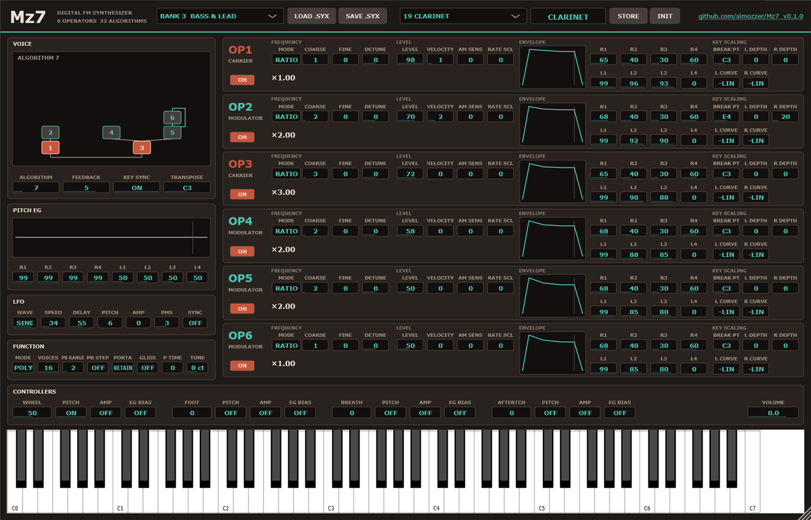

# Mz7

**A DX7 for your DAW.** Mz7 is a VST3 instrument (and an Audio Unit on the Mac, an LV2 on
Linux), and a standalone app, that emulates the Yamaha DX7 FM synthesizer of 1983. That's
the electric pianos, glassy bells, slap basses and brass stabs of the eighties, and a
programmable FM synthesizer underneath them.

Mz7 models the DX7's sound chip rather than FM in general:

- **Six operators, 32 algorithms.** Every algorithm as the front panel draws it, with
  feedback, including the three-operator feedback loops of algorithms 4 and 6, which many
  emulations reduce to an operator feeding itself.
- **The chip's own arithmetic.** The DX7's sound chip never multiplies. Its sine comes from a
  log-sine ROM, the envelope is added in the log domain, and an exponent ROM turns the sum
  back into a level. Mz7 does the same, integer for integer, from Ken Shirriff's
  reverse-engineering of the chip. Modulation is lined up as the chip lines it up, which
  gives the DX7's maximum index of about 4π at output level 99.
- **Its sample rate and its output.** It runs at the chip's own 49,096 Hz, so its aliasing is
  the DX7's, and is resampled to your DAW's rate. Each voice goes through the DX7's
  floating-point DAC (an 11-bit mantissa and a 2-bit exponent) on its own, then a 16 kHz
  filter. Algorithms with several carriers turn each down, as the chip does.
- **The envelopes, LFO and keyboard as measured.** Envelope rates and levels, the attack's
  jump and curve, the pause a stage takes when its level doesn't move, level and rate
  scaling, velocity, the pitch envelope, and the LFO's speeds, delay and six waves. These
  follow the measurements made on real DX7s for MSFA, the engine inside Dexed. Mz7 was
  checked against it patch by patch.
- **The machine around it.** Sixteen voices. One LFO shared by every note, as on the DX7. Key
  sync. Sustain. Mono with portamento, glissando and stepped pitch bend. The mod wheel, foot
  pedal, breath controller and aftertouch can each reach pitch, amplitude or EG bias.

And for modern use:

- **128 voices of its own** in four cartridges: *Classic*, *Keys & Mallets*, *Bass & Lead*
  and *Pads & FX*. They're all original, programmed for Mz7. None is Yamaha's.
- **Real DX7 cartridges.** LOAD .SYX opens any 32-voice DX7 cartridge or single voice. That
  includes Yamaha's ROMs and the thousands made since, which are easy to find online. SAVE
  .SYX writes a cartridge or a voice that a real DX7 or any DX7 editor will read. A sysex dump
  sent over MIDI loads too.
- **Every parameter on one panel.** Six operator rows, each with its envelope drawn, its
  frequency as a ratio or in Hz, and its keyboard scaling. A live algorithm diagram. The
  pitch envelope, LFO, FUNCTION settings and controllers. Every parameter can be automated
  from your DAW.
- **STORE writes your edit into a slot,** as on the DX7. Your cartridge and voice are saved
  with your project.

## Installing

Download `Mz7-<version>-win64-Setup.exe` from the
[releases page](https://github.com/simozzer/Mz7/releases) and run it. It installs the VST3,
the standalone app, or both, and asks whether to install for everyone or just you:

- **Everyone** (needs administrator rights) puts the VST3 in
  `C:\Program Files\Common Files\VST3`, which every DAW scans.
- **Just me** puts it in `%LOCALAPPDATA%\Programs\Common\VST3`. Some DAWs need that folder
  added to their plugin paths once. In Ableton Live it goes under
  *Preferences → Plug-Ins → VST3 Plug-In Custom Folder*.

Then rescan plugins in your DAW. The installer isn't code-signed, so Windows may warn about an
unknown publisher: choose *More info → Run anyway*. Uninstall from *Settings → Apps*.

The standalone app, `Mz7.exe`, plays without a DAW. Its *Options* button chooses the audio
and MIDI devices.

### macOS (beta)

Download `Mz7-<version>-macOS-beta.zip` from the
[releases page](https://github.com/simozzer/Mz7/releases) and unzip it. It holds the VST3,
an Audio Unit (for Logic and GarageBand) and the standalone app, for Apple Silicon and Intel
Macs on macOS 11 or later.

They aren't signed by Apple, which takes a paid developer account, so macOS won't open them
with a double-click. Install them from Terminal instead. Type `bash ` (with the space), drag
`install.sh` from the unzipped folder into the Terminal window, and press Return:

    bash ~/Downloads/Mz7-<version>-macOS-beta/install.sh

It copies everything into your own Library folders, with no password needed. It also clears
the "downloaded from the internet" flag that would stop your DAW loading the plugin. Then
rescan plugins in your DAW. `READ ME FIRST.txt` in the zip explains how to install by hand
instead.

### Linux (beta)

Download `Mz7-<version>-linux-x86_64-beta.tar.gz` from the
[releases page](https://github.com/simozzer/Mz7/releases) and unpack it. It holds the VST3,
an LV2 and the standalone app, for 64-bit x86 PCs on Ubuntu 22.04 or later, or another
distribution as new. For a **Raspberry Pi 5** on 64-bit Raspberry Pi OS (Bookworm or
later), download `Mz7-<version>-linux-arm64-beta.tar.gz` instead; it installs the same way. In the unpacked folder:

    bash install.sh

It copies the plugins into `~/.vst3` and `~/.lv2`, where Linux hosts look for them.

Both are betas: built and checked on GitHub's machines, but not yet tried much on real ones.
If something doesn't work, please [open an issue](https://github.com/simozzer/Mz7/issues).

## Playing it

- **A cartridge** is 32 voices. The box at the top picks one of the four built in, or the
  one you loaded. The box beside it picks a voice, and so does your DAW's program list.
- **Turning anything edits the voice,** as on the DX7. The cartridge doesn't change until
  STORE writes the voice into a slot. Choosing another voice drops an edit you haven't
  stored.
- **Values** are boxes. Drag them up or down, or use the mouse wheel. Double-click one to
  reset it. Hover over anything to see what it does.
- **An operator's ON** switch silences it while you listen to the rest. It isn't part of the
  voice.
- **INIT** starts a voice from scratch: algorithm 1, OP1 alone, a sine.

### A few numbers to program by

- **A modulator's output level** sets brightness. At 99 the modulation index is about 4π, and
  every 8 lower halves it: 91 is about 2π, 83 about π, 75 about π/2.
- **Envelope rates:** 99 is instant, around 70 takes hundredths of a second, around 50
  tenths, around 30 seconds.
- **Ratios:** coarse 0 is 0.5, then 1 to 31; fine adds that percentage. Fixed frequency is
  1, 10, 100 or 1000 Hz, times 10^(fine/100).
- **Velocity sensitivity 7** makes a key struck at 64 about 10 dB softer than one at 100.

## MIDI

Notes, velocity, pitch bend, the mod wheel (CC 1), breath (CC 2), the foot controller
(CC 4), sustain (CC 64), portamento on/off (CC 65), channel and key aftertouch, program
change (the cartridge's 32 slots), all notes off and all sound off. DX7 voice and cartridge
sysex dumps are received.

## Building

Needs Visual Studio 2022+ with *Desktop development with C++*, and JUCE checked out beside
this repository (`..\JUCE`, or pass `-DJUCE_PATH=`).

    .\build.ps1                 engine checks, then the VST3 and the standalone
    .\build.ps1 -NoPlugin       engine checks only
    .\build.ps1 -Wav out        and a WAV preview of every factory voice into out\
    .\build.ps1 -Release        and the release downloads into dist\: Setup.exe and two zips

There are two checks, and neither links JUCE:
- **EngineCheck** holds the engine to pitch, level and stability, and checks the sysex
  round trip.
- **BankCheck** plays all 128 factory voices. Each must sound, stay under full scale and die
  away once released.

`-Release` needs [Inno Setup 6](https://jrsoftware.org/isdl.php).

## Releasing

1. Bump the version in `CMakeLists.txt`.
2. Write the notes in `docs/releases/v<version>.md`, ending with the credit line, and commit
   both.
3. Tag and push: `git tag -a v0.2.0 -m "Mz7 0.2.0"`, then `git push origin main v0.2.0`.
4. The *release* workflow builds and checks the plugin, then makes a **draft** release with
   the Windows downloads. Its Mac and Linux jobs add theirs. Read it over on GitHub and
   publish it.

## Layout

- `Source/DX7/` is the engine, plain C++ with no JUCE. MzDebirth plays it as a rack machine
  from this same folder.
  - `Ops.h`: the sound chip's arithmetic.
  - `Algorithms.h`, `Envelopes.h` and `Lfo.h`.
  - `Engine.*`: the voices, controllers and output stage.
  - `Patch.*`: the voice format and sysex.
  - `Banks.*`: the 128 factory voices.
- `Source/` has the plugin: its parameters, processor and panel.
- `Tests/` has the checks.

## Not yet checked against hardware

The engine was checked against MSFA, not against a DX7. A few things are approximate:
- **Amplitude modulation** (tremolo, EG bias) follows MSFA's model, which MSFA itself calls
  rough.
- **The analogue output stage** is a simple 16 kHz two-pole filter, with no noise floor.
- **The factory voices** were programmed from FM recipes and checked by numbers, not by ear
  against the DX7 sounds they recall.

Recordings of a real DX7, voice by voice, are what would settle these.

## Licence

Created by Simon Moscrop.

Mz7 is free software under the GNU Affero General Public License v3; see [LICENSE](LICENSE).
It is built with [JUCE](https://juce.com), used under the same licence. The engine was
written for Mz7. It was checked against MSFA, Raph Levien's music-synthesizer-for-android as
carried on in Dexed (Apache 2.0), and follows the DX7 behaviour measured there and in Ken
Shirriff's die analysis.

Mz7 is an independent project and is not affiliated with Yamaha. DX7 is a trademark of
Yamaha Corporation.
